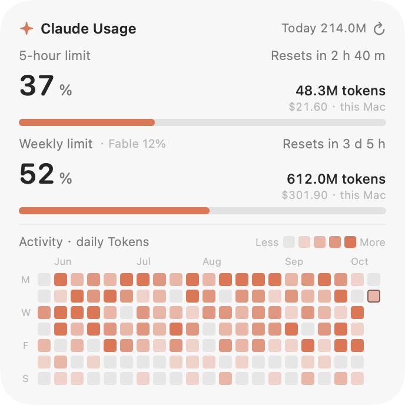
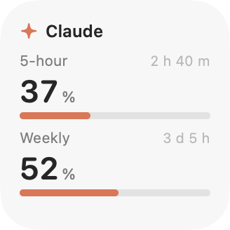
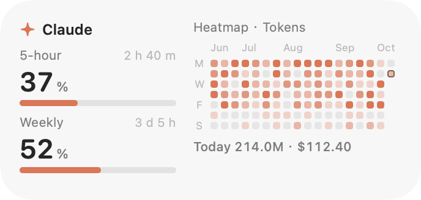
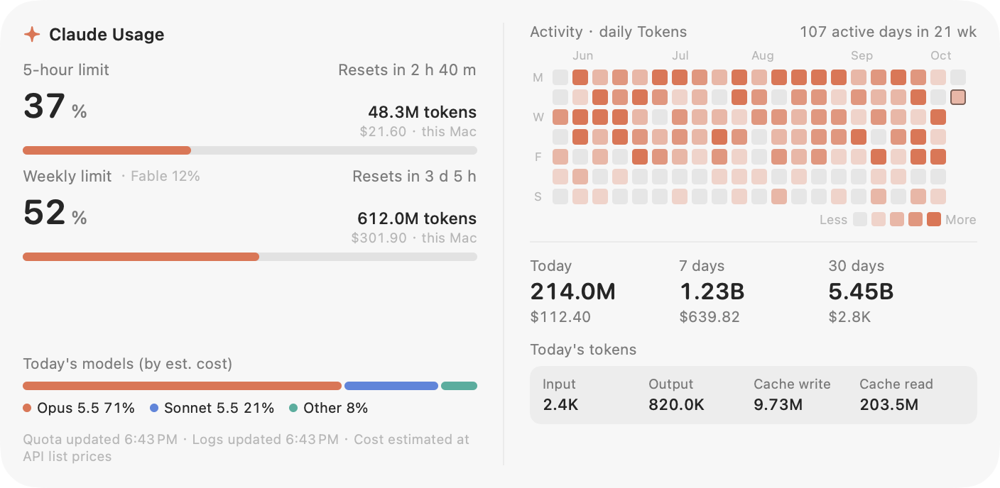

# Claude Usage Widget

**English** | [简体中文](README.zh-CN.md)

A native macOS desktop widget that shows the plan limits of a Claude subscription (5-hour and weekly), a GitHub-style activity heatmap, and the token usage and estimated cost of Claude Code on the local machine. The widget follows the size classes, corner radius and grid of the system's own desktop widgets.

<p align="center">
  <picture>
    <source media="(prefers-color-scheme: dark)" srcset="docs/images/large-en-dark.png">
    
  </picture>
</p>

> **Disclaimer.** This is an independent project. It is not affiliated with, endorsed by or sponsored by Anthropic. "Claude" is a trademark of Anthropic. Reading the plan limits relies on a web endpoint of claude.ai that is not a documented API (see [Data sources](#data-sources)); it can change or stop working without notice, and its use should be checked against Anthropic's terms.

## Features

- **Plan limits**: used percentage, reset countdown and the local usage inside the window for the 5-hour and weekly limits, plus per-model weekly limits where the plan has them. The bar turns yellow at 70 % and red at 90 %.
- **Activity heatmap**: one cell per day, five levels, Monday-first, tokens or message count per day. The history is stored by the widget, so it keeps growing after Claude Code has deleted old session logs.
- **Usage summary**: today, last 7 days and last 30 days (tokens and estimated cost), today's token composition and model split.
- **Native size classes**: small, medium, large and extra large, with the size, corner radius and grid snapping of system widgets and the Liquid Glass material on macOS 26.
- **English and Chinese**: the language follows the system and can be switched from the context menu.

## Size classes

| Class | Card (pt) | Content |
| --- | --- | --- |
| Small | 164 × 164 | 5-hour and weekly limits |
| Medium | 344 × 164 | Both limits, heatmap, today's usage |
| Large (default) | 344 × 344 | Both limits (with local window usage and per-model limits), heatmap |
| Extra Large | 704 × 344 | Large, plus 7/30-day totals, today's token composition and model split |

<p align="center">
  
  
</p>
<p align="center">
  
</p>

## Requirements

- macOS 14 or later. The Liquid Glass material is used on macOS 26; earlier systems fall back to a frosted background.
- Xcode Command Line Tools (`xcode-select --install`). Full Xcode is not required.
- Claude Code, if the local usage statistics and the heatmap are wanted. A Claude Pro or Max subscription and a claude.ai sign-in are needed for the plan limits.

## Build and install

```bash
git clone https://github.com/Yu-Xiang-Yang/claude-usage-widget.git
cd claude-usage-widget
./build.sh install          # builds and installs to /Applications (or ~/Applications)
open /Applications/ClaudeUsageWidget.app
```

`./build.sh` alone builds `build/ClaudeUsageWidget.app`. The script prefers the macOS 26 SDK when it is installed, because the default SDK of the Command Line Tools can be newer than the installed compiler (`this SDK is not supported by the compiler`). The app is ad-hoc signed.

## First run

1. Right-click the widget and choose **Sign In to claude.ai…**, then sign in in the window that opens. The window closes by itself when the plan limits have been read.
2. Optionally enable **Launch at Login** in the same menu. The widget registers itself as a login item (System Settings → General → Login Items & Extensions) for the path it runs from; re-enable it after moving the app.

Until a sign-in exists, the widget shows a local estimate of the 5-hour window and a *Sign in* button. The heatmap and the local statistics work without a sign-in.

## Context menu

Refresh Now · Size · Heatmap Metric (tokens or messages) · Language · Sign In to claude.ai… · Clear Sign-In · Keep on Top · Launch at Login · Hide Widget · Quit.

Dragging any empty part of the widget moves it. The position and the options are saved.

## Data sources

### Local usage

The widget reads the session logs of Claude Code (`~/.claude/projects/**/*.jsonl`, also `~/.config/claude/projects` and the directories in `CLAUDE_CONFIG_DIR`) and counts the `usage` of every assistant message.

- **Tokens** are input + output + cache writes + cache reads.
- **De-duplication**: a streamed message is logged several times; for every `message.id` and `requestId` the record with the highest output count is kept.
- **Cost** is an estimate at the published API list prices (`Pricing` in [`Sources/UsageStore.swift`](Sources/UsageStore.swift)). Cache writes are charged at 1.25× (5-minute TTL) or 2× (1-hour TTL) of the input price. Subscriptions are not billed per token, so the figure is only useful for comparison. The price table is maintained by hand.
- The logs are scanned incrementally every 30 s; the first full scan of 700 MB of logs takes about 2 s.

Only Claude Code on the local machine is counted. Chats in claude.ai and usage on other devices are not part of the local statistics.

### Plan limits

The percentages are computed by the server and are not part of the local logs. The widget therefore uses the same data as the claude.ai usage page:

1. The sign-in window is an embedded WebKit view. The sign-in is kept in the widget's own WebKit data store.
2. At most once per minute the widget loads `/api/organizations/<organization>/usage` in that store. The `limits` list of the response contains the windows `session` (5 hours), `weekly_all` and `weekly_scoped` (per model), each with a percentage and a reset time. The older `five_hour` and `seven_day` fields are used as a fallback.
3. The result is cached in `quota.json`, so it is shown immediately after a restart.

The endpoint is not a public API. If it changes, the widget falls back to the local estimate and shows the reason; it never displays a made-up percentage. **Clear Sign-In** deletes the WebKit data, the stored organization and `quota.json`.

The sign-in window hides the WebAuthn API. A locally built app does not hold the entitlement that browsers need for passkeys; a page that detects WebAuthn offers a passkey and the flow then stalls. With WebAuthn hidden, Google and claude.ai use passwords, device prompts or e-mail codes instead. Pop-up windows are supported because the Google and Apple flows use them. An e-mail sign-in link opens in the default browser, not in the widget; use the code instead.

### Stored files

| Path | Content |
| --- | --- |
| `~/Library/Application Support/ClaudeUsageWidget/history.json` | Per-day totals (tokens, messages, cost) |
| `~/Library/Application Support/ClaudeUsageWidget/quota.json` | Last plan-limit reading |
| `~/Library/WebKit/local.claude-usage-widget/` | WebKit data of the claude.ai sign-in |

The only network access is to claude.ai, for the plan limits.

## Window behaviour

System widgets are WidgetKit extensions that must be code-signed with a developer certificate, which requires full Xcode. This project does not use one, so the widget is a separate borderless panel and does not appear in the system widget gallery. It reproduces the geometry of system widgets measured on macOS 26:

- A system widget window of 180 × 180, 360 × 180 or 360 × 360 pt contains a card inset by 8 pt on every side, so the cards are 164 × 164, 344 × 164 and 344 × 344 pt. The extra large class follows the same 180 pt grid (704 × 344 pt card) and has not been measured.
- The corner radius is 27 pt (a circular arc fitted to the system cards; the outlines differ by at most 3 px).
- Cards keep 16 pt from the screen edges and the menu bar. While dragging, the widget snaps to those margins, to the screen centre lines and to the 180 pt grid within 14 pt, and it stays on screen. It also settles on the grid after a launch or a size change.
- The panel sits above the desktop icons and below normal windows, on all spaces. A maximized window therefore hides it; use **Keep on Top** to change that.
- No drop shadow is drawn, as on the desktop.

## Command line

```bash
ClaudeUsageWidget --dump                       # aggregate as JSON
ClaudeUsageWidget --snapshot out.png [--size small|medium|large|extraLarge] \
                  [--lang zh|en] [--appearance light|dark] [--demo]
ClaudeUsageWidget --parse-usage                # parse a usage response from stdin
ClaudeUsageWidget --show-login                 # open the sign-in window at launch
ClaudeUsageWidget --login-item on|off|status   # register, remove or query the login item
ClaudeUsageWidget --probe-webauthn             # show the effect of hiding WebAuthn
CLAUDE_USAGE_WIDGET_DIR=/path ...              # use another data directory
```

`--demo` renders synthetic data; the images in `docs/images` were produced with it.

## Project layout

| File | Role |
| --- | --- |
| `Sources/main.swift` | Entry point and command-line modes |
| `Sources/AppController.swift` | Panel, size classes, snapping, status item, login item |
| `Sources/WidgetView.swift` | SwiftUI layouts of the four size classes |
| `Sources/UsageStore.swift` | Log scanner, pricing, aggregation |
| `Sources/UsageModel.swift` | Refresh schedule and published state |
| `Sources/QuotaFetcher.swift` | WebKit fetcher and sign-in window |
| `Sources/Support.swift` | Quota parser and cache, daily history, size classes |
| `Sources/Localization.swift` | Language preference and formatting |
| `Sources/Demo.swift` | Synthetic data for screenshots |

## Limitations

- Local statistics cover Claude Code on this machine only.
- The plan limits depend on an undocumented web endpoint and on a valid sign-in.
- The extra large size is derived from the system grid, not measured.
- The menu bar item may be hidden by macOS when the menu bar is full (for example next to the notch).
- The price table needs manual updates when prices change; models without a match are priced like `claude-opus-5-5`.

## License

[MIT](LICENSE)
