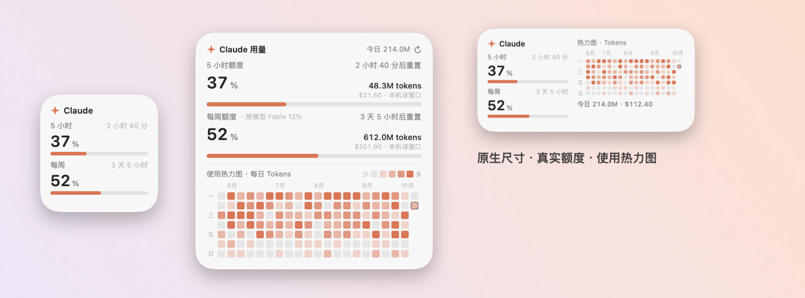
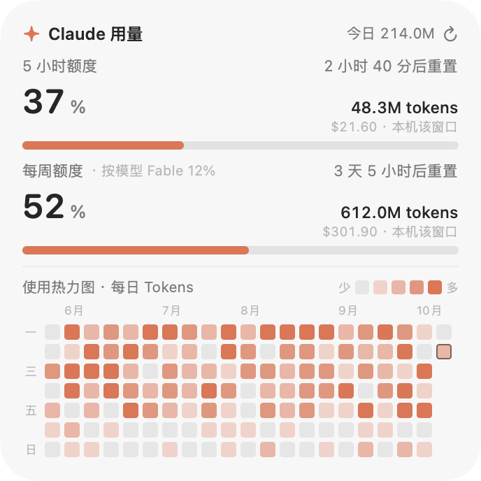
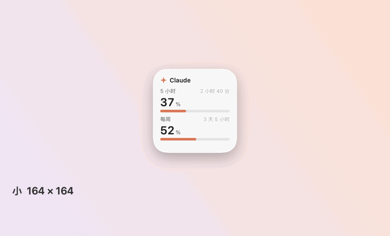

# Claude 用量桌面小组件

[English](README.md) | **简体中文**


macOS 原生桌面小组件，显示 Claude 订阅的 5 小时与每周额度、类似 GitHub 的使用热力图，以及本机 Claude Code 的 token 用量与估算费用。组件的尺寸、圆角与摆放网格与系统自带的桌面小组件一致。

[](https://github.com/Yu-Xiang-Yang/claude-usage-widget/releases/latest)
[](https://github.com/Yu-Xiang-Yang/claude-usage-widget/actions/workflows/build.yml)
[](LICENSE)


<p align="center">
  
</p>

> **声明**：本项目为独立项目，与 Anthropic 无隶属、认可或赞助关系。“Claude”为 Anthropic 的商标。额度数据依赖 claude.ai 的一个未公开文档的网页接口（见[数据来源](#数据来源)），该接口可能随时变更或失效，使用前应核对 Anthropic 的服务条款。

## 下载

1. 打开[最新发布页](https://github.com/Yu-Xiang-Yang/claude-usage-widget/releases/latest)，下载 `ClaudeUsageWidget-<版本>-macos.zip`（通用二进制，支持 Apple 芯片与 Intel）。
2. 解压后将 `ClaudeUsageWidget.app` 移入 `/Applications`。
3. 应用采用临时签名且未经公证，首次启动会被系统拦截。执行一次下列命令移除隔离标记：

   ```bash
   xattr -dr com.apple.quarantine /Applications/ClaudeUsageWidget.app
   ```

   也可在「系统设置 → 隐私与安全性」中选择「仍要打开」。
4. 打开应用并按[首次使用](#首次使用)操作。发布页附有校验和，源码即本仓库。

## 功能

- **订阅额度**：5 小时与每周额度的已用百分比、重置倒计时与本机日志在该窗口内的用量；套餐含按模型的每周额度时一并显示。≥ 70 % 显示为黄色，≥ 90 % 显示为红色。
- **使用热力图**：每日一格，5 级色阶，周一为每周首日，可按 tokens 或消息数着色。历史由组件自行保存，Claude Code 清理旧会话日志后仍会保留。
- **用量汇总**：今日、近 7 日、近 30 日的 tokens 与估算费用，今日 token 构成与模型占比。
- **原生尺寸**：小、中、大、特大四档，尺寸、圆角与网格吸附与系统小组件一致；macOS 26 上使用 Liquid Glass 材质。
- **中英文**：语言跟随系统，可在右键菜单中切换。

## 尺寸

| 尺寸 | 卡片（pt） | 内容 |
| --- | --- | --- |
| 小 | 164 × 164 | 5 小时与每周额度 |
| 中 | 344 × 164 | 两项额度、热力图、今日用量 |
| 大（默认） | 344 × 344 | 两项额度（含本机窗口用量与按模型额度）、热力图 |
| 特大 | 704 × 344 | 大尺寸全部内容；按模型的每周额度（如 Fable）各占一行并显示本机在该窗口内的对应用量；另含近 7 / 30 日汇总、今日 token 构成、模型占比 |

<p align="center">
  <picture>
    <source media="(prefers-color-scheme: dark)" srcset="docs/images/large-zh-dark.png">
    
  </picture>
  <br>
  
</p>

## 环境要求

- macOS 14 及以上。macOS 26 使用 Liquid Glass 材质，更早的系统回退为毛玻璃背景。
- Xcode 命令行工具（`xcode-select --install`），无需完整 Xcode。
- 本机用量统计与热力图需要 Claude Code；订阅额度需要 Claude Pro 或 Max 订阅及 claude.ai 登录。

## 从源码构建

```bash
git clone https://github.com/Yu-Xiang-Yang/claude-usage-widget.git
cd claude-usage-widget
./build.sh install          # 构建并安装到 /Applications（无写入权限时安装到 ~/Applications）
open /Applications/ClaudeUsageWidget.app
```

单独执行 `./build.sh` 仅生成 `build/ClaudeUsageWidget.app`。命令行工具的默认 SDK 版本可能高于已安装的编译器（报错 `this SDK is not supported by the compiler`），脚本因此在存在 macOS 26 SDK 时优先使用它。应用采用临时（ad-hoc）签名。

## 首次使用

1. 右键小组件，选择「登录 claude.ai…」，在弹出的窗口中登录。读取到额度后窗口自动关闭。
2. 可在同一菜单中启用「登录时启动」。组件以当前所在路径注册为系统登录项（系统设置 → 通用 → 登录项与扩展）；移动应用位置后需重新启用。

未登录时，组件显示按本地日志估算的 5 小时窗口与「登录」按钮；热力图与本机统计不依赖登录。

## 右键菜单

立即刷新 · 尺寸 · 热力图指标（tokens 或消息数） · 语言 · 登录 claude.ai… · 清除登录状态 · 窗口置顶 · 登录时启动 · 隐藏小组件 · 退出。

拖动组件任意空白处可移动位置；位置与选项自动保存。

## 数据来源

### 本机用量

组件读取 Claude Code 的会话日志（`~/.claude/projects/**/*.jsonl`，以及 `~/.config/claude/projects` 与 `CLAUDE_CONFIG_DIR` 指定的目录），累加每条助手消息的 `usage`。

- **tokens**：输入 + 输出 + 缓存写入 + 缓存读取。
- **去重**：流式消息会被多次写入日志；对同一 `message.id` 与 `requestId`，保留输出 token 最大的一条。
- **费用**：按公布的 API 标价估算（见 [`Sources/UsageStore.swift`](Sources/UsageStore.swift) 中的 `Pricing`）。缓存写入按输入价的 1.25 倍（5 分钟 TTL）或 2 倍（1 小时 TTL）计。订阅套餐不按 token 计费，该数值仅用于横向比较；价格表需手动维护。
- 日志每 30 s 增量扫描一次；700 MB 日志的首次全量扫描约 2 s。

仅统计本机的 Claude Code，claude.ai 网页端对话与其他设备的用量不在本机统计内。

### 订阅额度

额度百分比由服务端计算，本地日志不含该信息。组件采用与 claude.ai 用量页相同的数据：

1. 登录窗口为内嵌的 WebKit 视图，登录态保存在组件自身的 WebKit 数据存储中。
2. 组件至多每分钟在该存储中加载一次 `/api/organizations/<组织>/usage`。响应中的 `limits` 列表包含 `session`（5 小时）、`weekly_all` 与 `weekly_scoped`（按模型）三类窗口，均含百分比与重置时间；旧字段 `five_hour`、`seven_day` 作为后备。
3. 结果缓存于 `quota.json`，重启后立即显示。

该接口并非公开 API。接口变更时，组件回退为本地估算并显示原因，不会显示虚构的百分比。「清除登录状态」会删除 WebKit 数据、已保存的组织标识与 `quota.json`。

登录窗口屏蔽了 WebAuthn 接口：本地构建的应用不具备浏览器类应用的通行密钥授权，页面检测到 WebAuthn 可用便优先提供通行密钥，随后流程停滞。屏蔽后，Google 与 claude.ai 改用密码、设备确认或邮箱验证码。Google 与 Apple 登录在弹出窗口中进行，窗口已支持弹窗。邮件中的登录链接会在默认浏览器中打开，登录态不会进入组件，应使用验证码。

### 存储的文件

| 路径 | 内容 |
| --- | --- |
| `~/Library/Application Support/ClaudeUsageWidget/history.json` | 每日汇总（tokens、消息数、费用） |
| `~/Library/Application Support/ClaudeUsageWidget/quota.json` | 最近一次额度读数 |
| `~/Library/WebKit/local.claude-usage-widget/` | claude.ai 登录态的 WebKit 数据 |

组件唯一的网络访问是为读取额度而访问 claude.ai。

## 窗口行为

系统小组件是 WidgetKit 扩展，须以开发者证书签名，而构建它需要完整 Xcode。本项目不使用 WidgetKit，组件因此是独立的无边框面板，不出现在系统小组件库中；其几何参数取自 macOS 26 上系统小组件的实测值：

- 系统小组件窗口为 180 × 180、360 × 180 或 360 × 360 pt，卡片在窗口内四周各缩进 8 pt，故卡片为 164 × 164、344 × 164 与 344 × 344 pt。特大尺寸按同一 180 pt 网格推算（卡片 704 × 344 pt），未经实测。
- 圆角为 27 pt（对系统卡片的圆弧拟合，轮廓缩进差不超过 3 px）。
- 卡片距屏幕边缘与菜单栏 16 pt。拖动时，组件向这些边距、屏幕中线与 180 pt 网格线吸附（阈值 14 pt），并始终保持在屏幕内；启动与切换尺寸后同样落到网格上。
- 面板位于桌面图标之上、普通窗口之下，所有空间可见。最大化窗口会将其遮挡，可启用「窗口置顶」。
- 不绘制投影，与桌面上的系统小组件一致。

## 命令行

```bash
ClaudeUsageWidget --dump                       # 以 JSON 输出聚合结果
ClaudeUsageWidget --snapshot out.png [--size small|medium|large|extraLarge] \
                  [--lang zh|en] [--appearance light|dark] [--demo]
ClaudeUsageWidget --parse-usage                # 从标准输入解析额度响应
ClaudeUsageWidget --show-login                 # 启动时打开登录窗口
ClaudeUsageWidget --login-item on|off|status   # 注册、移除或查询登录项
ClaudeUsageWidget --probe-webauthn             # 展示屏蔽 WebAuthn 的效果
CLAUDE_USAGE_WIDGET_DIR=/path ...              # 改用其他数据目录
```

`--demo` 渲染合成数据；`docs/images` 中的图片由此生成。

## 项目结构

| 文件 | 作用 |
| --- | --- |
| `Sources/main.swift` | 入口与命令行模式 |
| `Sources/AppController.swift` | 面板、尺寸、吸附、状态栏图标、登录项 |
| `Sources/WidgetView.swift` | 四档尺寸的 SwiftUI 布局 |
| `Sources/UsageStore.swift` | 日志扫描、定价、聚合 |
| `Sources/UsageModel.swift` | 刷新调度与发布状态 |
| `Sources/QuotaFetcher.swift` | WebKit 取数与登录窗口 |
| `Sources/Support.swift` | 额度解析与缓存、每日历史、尺寸定义 |
| `Sources/Localization.swift` | 语言偏好与格式化 |
| `Sources/Demo.swift` | 截图用的合成数据 |
| `Resources/AppIcon.icns` | 应用图标，由 `scripts/make-icon.swift` 生成 |
| `scripts/` | 图标与文档图片的生成脚本 |

## 常见问题

- **「无法打开，因为无法验证开发者」**：见[下载](#下载)第 3 步。
- **看不到小组件**：它位于桌面图标之上、普通窗口之下，最大化窗口会将其遮挡。可启用「窗口置顶」或显示桌面。若曾通过菜单隐藏，在访达或 Spotlight 中再次打开应用即可显示。
- **额度处显示「登录」按钮**：尚未登录或登录已失效，请在右键菜单中重新登录。登录窗口若出现通行密钥提示，请改用密码、设备确认或邮箱验证码；本地构建的应用无法完成通行密钥，组件因此将其屏蔽。
- **百分比与用量页不一致**：组件约每分钟刷新一次额度，额度旁的用量仅统计本机的 Claude Code。
- **没有菜单栏图标**：系统会隐藏刘海旁放不下的状态栏图标；所有功能也可从小组件的右键菜单使用。

## 局限

- 本机统计仅覆盖本机的 Claude Code。
- 订阅额度依赖未公开的网页接口与有效的登录态。
- 特大尺寸由系统网格推算，未经实测。
- 菜单栏空间不足时（如刘海屏），系统可能隐藏菜单栏图标。
- 价格变动时需手动更新价格表；未匹配的模型按 `claude-opus-5-5` 价格计。

## 许可证

[MIT](LICENSE)
